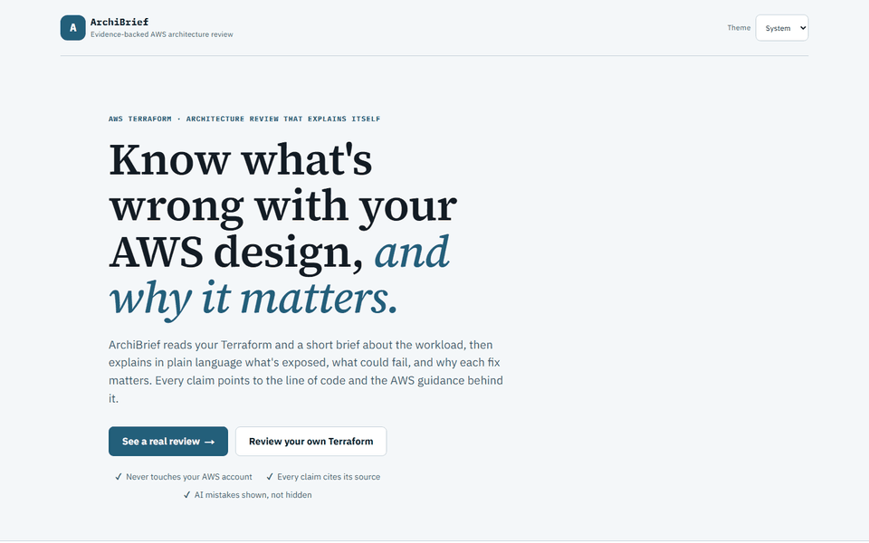
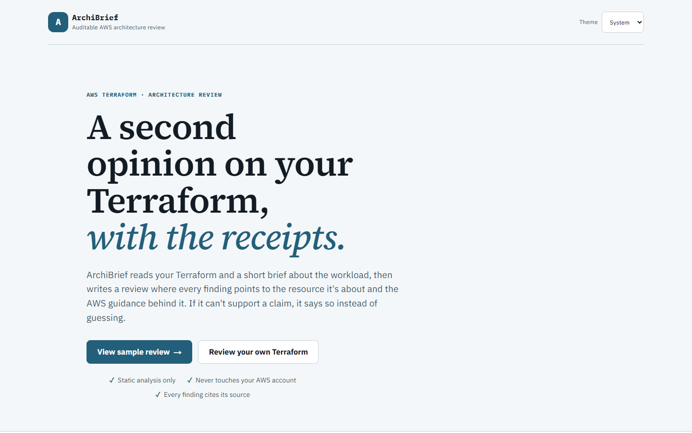
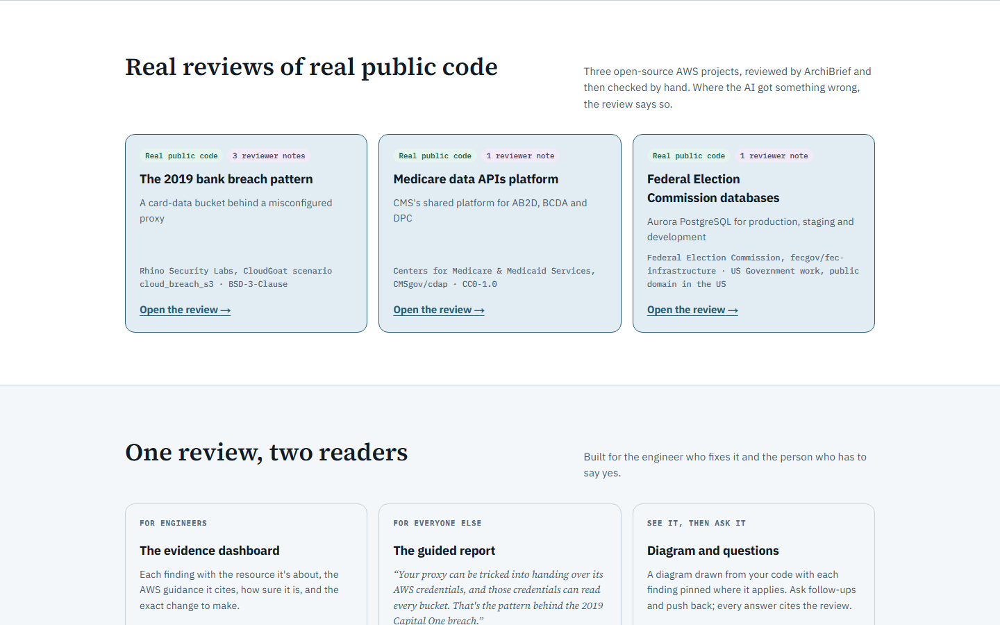
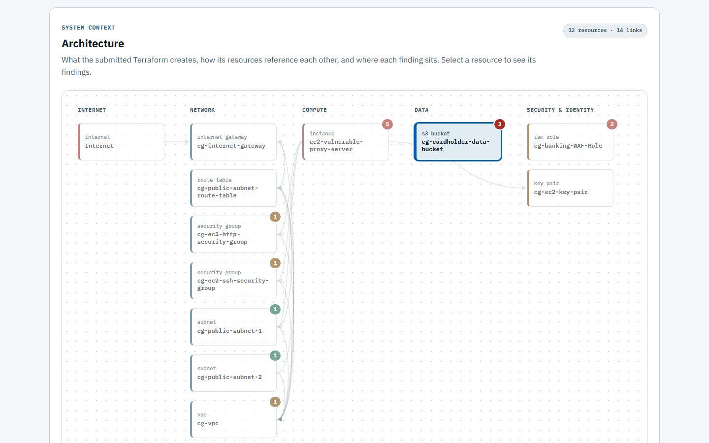
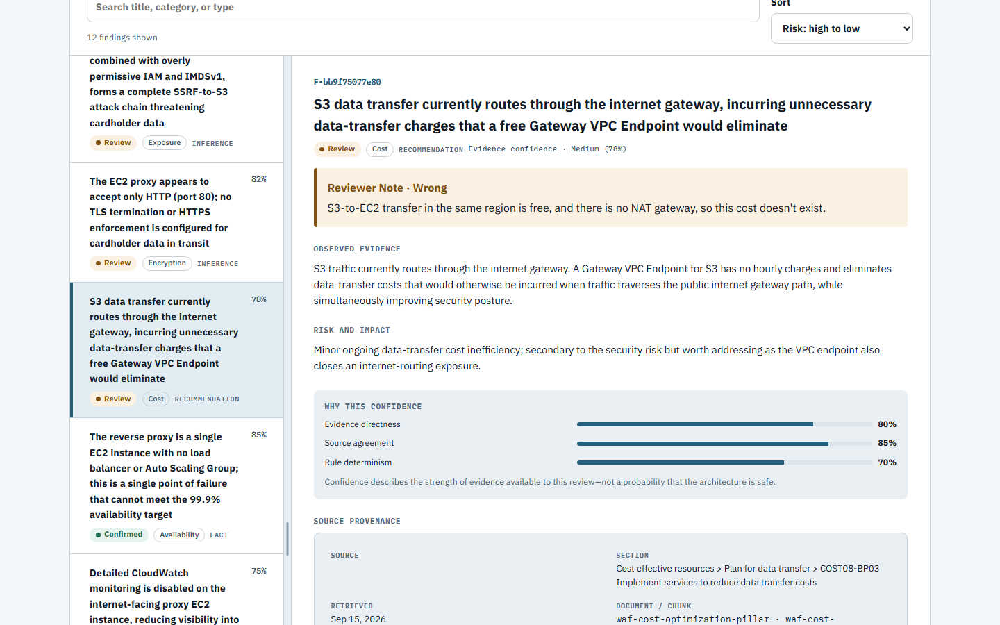
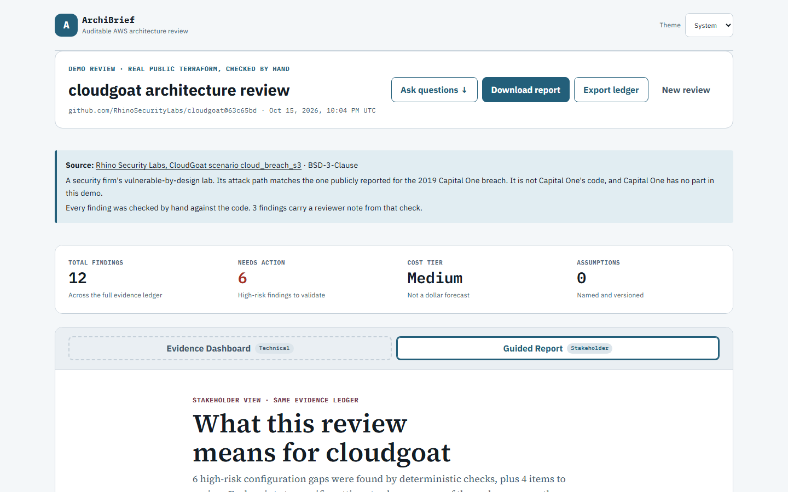
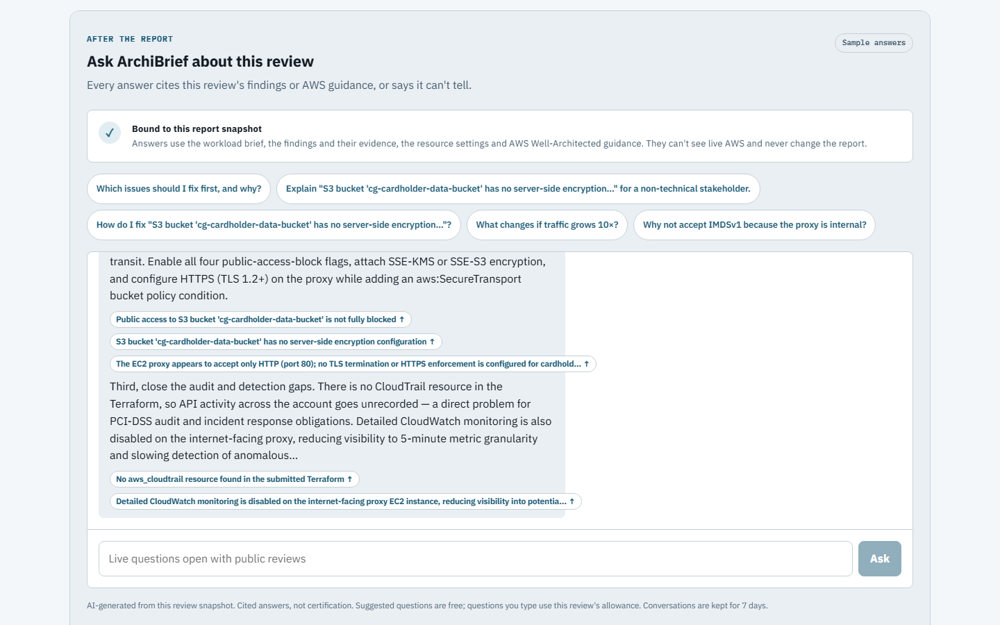
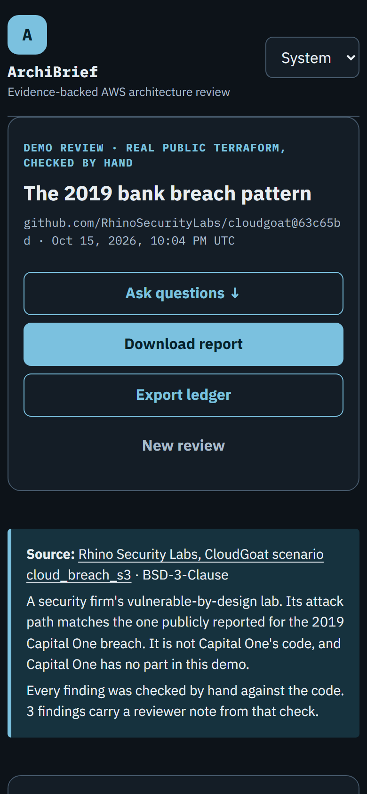

# ArchiBrief

[](https://github.com/nandohtorres/archibrief/actions/workflows/ci.yml)
[](LICENSE)

**Context-aware architecture review with receipts.** Live at [archibrief.dev](https://archibrief.dev).

ArchiBrief combines static Terraform checks with a workload brief and retrieved AWS guidance. A public bucket means something different for public records than for cardholder data; availability advice needs a traffic profile and a target. The report puts the observed configuration, risk, recommendation, alternatives, and confidence alongside its evidence so a reviewer can challenge the result.

## Status

**Live and open to the public.** Anyone can submit Terraform for a review, within a few free reviews a day (each one calls a paid model), and there are three finished demo reviews to open first. The demos cover real public Terraform: a security firm's breach lab, a Medicare data platform, and FEC databases. They load from saved files, so opening one starts no model run. Each finding was checked by hand against the code, and the ones the model got wrong carry a visible reviewer note ([docs/demos.md](docs/demos.md)).

**Report chat is live.** Questions about one finished review get cited answers checked server-side against that review ([docs/chat.md](docs/chat.md), [ADR-0050](docs/adr/0050-grounded-chat-build.md)). It runs on Claude Sonnet 4.6 behind Guardrails, a five-question limit per review and a daily estimated-cost allowance. On the demos, the suggested questions' answers were generated once and are served free.

**How public use is bounded:** a Cloudflare Turnstile check before each upload, AWS WAF in front of the API, and spending limits reserved in DynamoDB before every paid call, globally, per visitor and per review ([public access design](docs/public-access-implementation.md)). Not yet done: the paid chat evaluation.

## How it works

1. Upload a bounded Terraform archive and describe the workload. Ingestion validates the archive and parses HCL statically; it does not run Terraform, providers, or provisioners.
2. Trivy supplies selected trusted checks, augmented by ArchiBrief's deterministic rules. If scanning is unavailable, rules still run and scanner status is recorded.
3. Preflight requests missing context or records explicit defaults. Step Functions owns the review lifecycle and clarification pause/resume.
4. A LangGraph subworkflow on Bedrock AgentCore retrieves AWS guidance and reasons over the brief, rule findings, and a sanitized resource summary. The reasoning model does not receive raw Terraform.
5. Server-side validation checks typed findings and citation provenance before audit/finalization. A model finding's quote must match a retrieved chunk. Deterministic findings use configuration evidence rather than model citations.

The frontend exposes progress, clarification, findings, a stakeholder view of the same evidence, per-finding “go deeper,” report chat, and an HTML report download that includes the conversation. See [architecture](docs/architecture.md), [threat model](docs/threat-model.md), [evaluation](docs/evaluation.md), and [Trivy comparison](docs/comparison.md).

The [engineering case study](docs/case-study.md) explains the tradeoffs and a reporting failure found during review.

## What the receipts establish—and their limits

- A matching citation proves that a passage exists in retrieved material; it does **not** prove the passage supports the conclusion. The saved breach report includes a weak attack-chain citation and an incorrect data-transfer cost claim; [the demo audit](docs/demos.md) records both.
- This is static review of the submitted slice, not inspection of deployed AWS resources, a complete dependency graph, a compliance certification, or a penetration test. Remote modules are neutralized before scanning.
- Counts, expressions, missing modules, and omitted settings limit what the model can observe. The demo audits found three such gaps (resource counts, backup plans, snapshot settings); each was fixed in the resource summary, and the FEC demo was re-run after the count fix.
- Trap tests cover their fixtures. Mocked tests do not measure live model quality, production IAM correctness, or deployed accessibility.
- “Go deeper” is synchronous with a bounded agent timeout; long requests can fail.
- Reviews are reachable for seven days, but deletion is asynchronous and backups last longer; there is no seven-day physical-deletion guarantee ([privacy](https://archibrief.dev/privacy.html)).

## Stack

| Layer | Implementation |
|---|---|
| UI | Next.js, React, TypeScript; static export to S3/CloudFront |
| Orchestration | API Gateway REST API with AWS WAF, Lambda, Step Functions |
| Static review | Python, python-hcl2, Trivy, custom deterministic rules |
| Reasoning | LangGraph on Bedrock AgentCore; Bedrock Claude, Guardrails |
| Retrieval | Titan V2 embeddings, S3 Vectors, lexical companion index |
| Storage | S3, DynamoDB |
| Infrastructure | Terraform modules in `infra/` |
| Verification | pytest/moto, Vitest, Playwright; `.github/workflows/ci.yml` |

## Local development

Use Python 3.12+ in an active virtual environment and Node 22.12+ or 24. Runtime dependency declarations are in `backend/pyproject.toml`; install the locked development set used by CI. From the repository root:

```text
python -m pip install -r backend/dev-requirements.lock.txt
python -m pytest tests/backend -m "not coverage_gap" -q
cd frontend
npm ci
npm run dev
```

Without `NEXT_PUBLIC_API_BASE_URL`, the UI uses the local fixture path. Leave the frontend env file absent for that mode; `frontend/.env.example` documents deployed API settings. Playwright builds separate fixture, closed-submission and public-preview mocked-API static sites; its API tests do not require AWS credentials. `coverage_gap` cases remain available separately and include documented intentional failures; excluding them is not evidence of passing that coverage. See [evaluation](docs/evaluation.md) for scope and reproducible commands. Live retrieval/model runners make paid service calls and are separate from these tests.

Direct demo links: [breach pattern](https://archibrief.dev/?demo=breach-pattern), [Medicare platform](https://archibrief.dev/?demo=medicare-platform), [FEC databases](https://archibrief.dev/?demo=fec-database). These require the frontend containing the link/recovery changes to be deployed.

## Screenshots

Live at **[archibrief.dev](https://archibrief.dev)**: open any of the three demo reviews without an account.



| | |
|---|---|
|  |  |
| **Landing.** Know what's wrong with your AWS design, and why it matters. | **Real demos.** Three reviews of real public Terraform, checked by hand. |
|  |  |
| **Diagram.** Drawn from the code without a model; each finding sits on the resource it names. | **Evidence.** Each finding shows its evidence, confidence and source; the hand check's note marks one the model got wrong. |
|  |  |
| **Guided report.** The same evidence in plain language, for the person who has to say yes, with what each fix costs per month and what not fixing could cost. | **Chat.** Answers cite this review's findings or AWS guidance. |
|  | |
| **Phone, dark theme.** | |

## Repository map

`backend/lambdas/` contains pipeline and API handlers; `backend/agent/` contains reasoning and its evaluation harnesses; `backend/chat/` contains the built chat path; `backend/corpus/` builds and evaluates retrieval. `frontend/` is the static web app, `tests/` holds unit tests, and `docs/adr/` records decisions.

## License

[MIT](LICENSE). Demo archives carry their upstream license/provenance; see [docs/demos.md](docs/demos.md).
