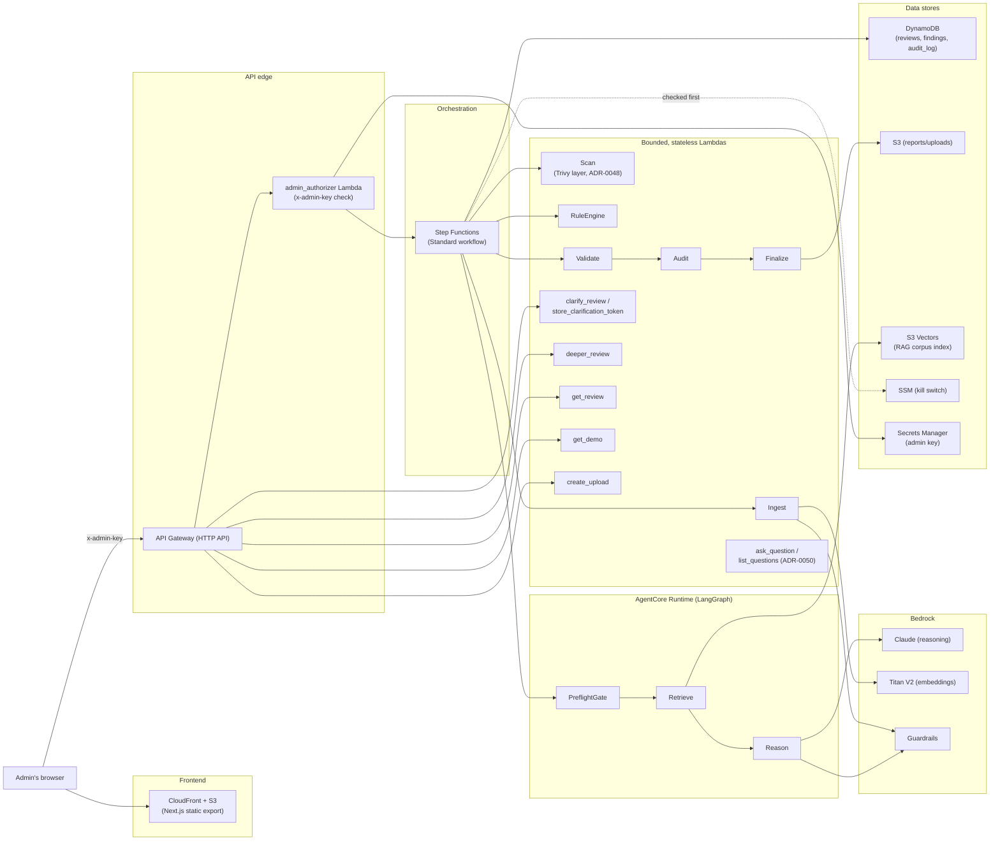
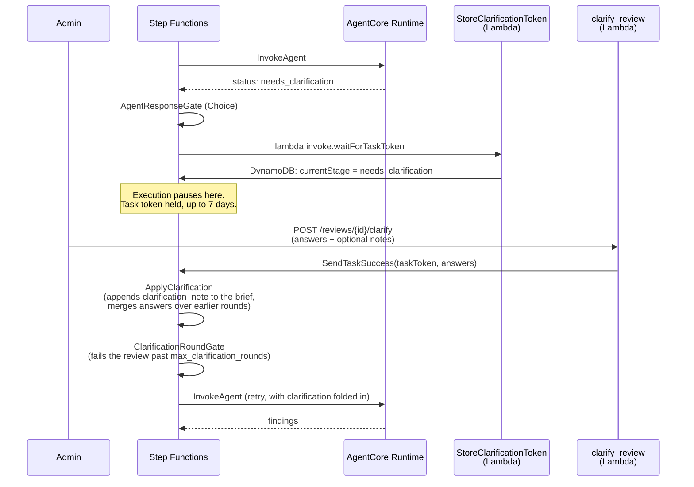

# ArchiBrief Architecture

Written against the real deployed system as of 2026-10-15. Diagrams are
Mermaid rather than `mingrammer/diagrams` (ADR-0025's stated tool) —
that needs a local Graphviz install this machine doesn't have, and
ADR-0025 itself calls its own choice "low-stakes, easily revisited," so
this is a documented substitution, not a reversal.

## System overview

## Review pipeline, step by step

1. **Submit** — the admin's browser uploads a Terraform archive directly
   to S3 via a presigned POST (`create_upload`), then calls
   `POST /reviews` with the archive's S3 key, a workload brief, and a
   repo reference. API Gateway integrates `POST /reviews` directly with
   Step Functions `StartExecution` — no Lambda in that specific path.
2. **IdempotencyGate** — a conditional `PutItem` using the client's
   `review_id` as the idempotency key; a duplicate submission succeeds
   immediately without re-running anything.
3. **CheckKillSwitch** — an SSM `GetParameter` read; if set, the
   execution fails fast here, before any Bedrock/AgentCore work starts.
4. **Ingest** — downloads the archive from S3, statically parses the
   Terraform with `python-hcl2` (never executes it), runs the content
   through Bedrock Guardrails.
5. **Scan** — runs Trivy (pinned, checksum-verified, shipped as a Lambda
   layer) over the uploaded Terraform in its own Lambda: no AWS
   credentials in its environment, no network, remote module sources
   rewritten before scanning, read-only access to `uploads/`. If it fails
   for any reason the review continues without it and says the scanner
   didn't run (ADR-0048).
6. **RuleEngine** — deterministic checks against the parsed Terraform,
   independent of any model call: Trivy's 16 trusted checks when Scan
   ran, plus ArchiBrief's own rules for what Trivy misses (and for
   everything, if Scan didn't run). It also builds a sanitized resource
   summary (allowlisted settings, documented defaults, values restricted
   to each setting's real formats) that Reason receives instead of the
   raw Terraform (ADR-0049).
7. **PreflightGate → Retrieve → Reason** (AgentCore Runtime) — resolves
   per-field missing-data policy, retrieves relevant RAG chunks from S3
   Vectors (embedded via Titan V2), and reasons over
   workload brief + rule findings + retrieved evidence via Claude.
   Guardrails runs again immediately before this step. If a required
   field truly can't be resolved, the workflow pauses at
   `StoreClarificationToken` (a `waitForTaskToken` state, up to 7 days)
   until the admin answers via `POST /reviews/{reviewId}/clarify`.
8. **Validate** — schema-checks every returned finding and independently
   verifies each citation resolves to a real retrieved chunk; a finding
   that fails either check is rejected, not silently kept.
9. **Audit → Finalize** — assembles the evidence ledger, persists it to
   S3, and updates the review's DynamoDB pointer item.
10. **Read results** — `GET /reviews/{reviewId}` returns the assembled
   report; `POST /reviews/{reviewId}/findings/{findingId}/deeper`
   re-invokes AgentCore (Retrieve → Reason(deep) → Validate) scoped to
   one finding, bypassing the rest of the pipeline entirely.
11. **Ask about it** — `POST /reviews/{reviewId}/questions` answers one
   question with a single Bedrock call over the stored review (findings
   under aliases, the resource summary, three retrieved WAF chunks, the
   last four turns), and the server keeps only what it can verify
   against the review. Admin-only until Phase 3; see `docs/chat.md`.

`GET /demo` is the one route with no Lambda/Step Functions/Bedrock cost
at all — a precomputed, static reference report, deliberately
unauthenticated (ADR-0029).

## Human-in-the-loop: the clarification pause

A real, live-tested path (first exercised end to end 2026-10-13),
not a hypothetical. When `Reason` can't resolve a required field under
ADR-0031's per-field missing-data policy, it returns
`needs_clarification` instead of findings, and the state machine pauses
— for up to 7 days — rather than guessing or failing the review:

The frontend never sees `needs_clarification` as a generic "still
pending" state — polling explicitly branches on it (found and fixed
2026-10-12: before that fix, a genuinely paused review looked
indistinguishable from a dead one to the client) and renders a real
yes/no + multi-select question UI instead of continuing to spin.

## Why Step Functions owns orchestration, not a Lambda

Per ADR-0028: Step Functions (Standard) owns only the durable outer job
lifecycle — accept, validate, persist input, invoke the agent stage
once, validate/persist the result, publish status. The actual
reasoning subworkflow (PreflightGate → Retrieve → Reason) runs as its
own LangGraph graph inside Bedrock AgentCore Runtime, invoked once via
a direct AWS SDK integration task, not re-implemented as more Step
Functions states.
