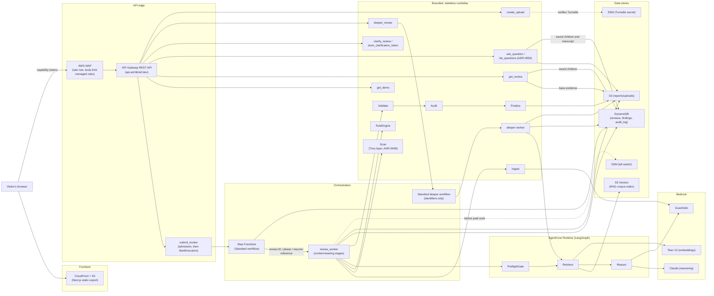

# ArchiBrief Architecture

This describes the source architecture. Deployment checks are recorded separately;
reading this document does not establish that a particular revision is live.
Diagrams are Mermaid rather than
`mingrammer/diagrams` (ADR-0025's stated tool), which needs a local
Graphviz install; ADR-0025 calls its own choice "low-stakes, easily
revisited," so this is a documented substitution, not a reversal.

## System overview



## Review pipeline, step by step

1. **Submit** — after a Turnstile check, `create_upload` reserves an
   upload and returns a checksum-bound presigned PUT; the browser uploads
   the archive straight to S3, then calls `POST /reviews` with the
   archive's version, a workload brief and a repo reference.
   `submit_review` verifies the exact upload, reserves the review's
   estimated cost against the spending limits and starts the Step
   Functions execution.
2. **Dispatch and worker claim** — upload IDs are server-issued. Admission,
   immutable input binding and a stable Standard execution name prevent retries
   from starting another paid job. `review_worker` conditionally claims the
   initial or resumed work using the stored review record.
3. **Kill switch** — admission and the worker check the SSM switch before
   paid work. The worker loads content from `jobs/<review_id>/` in S3;
   Step Functions state carries identifiers/status, not briefs or findings.
4. **Ingest** — downloads the archive from S3, statically parses the
   Terraform with `python-hcl2` (never executes it), runs the content
   through Bedrock Guardrails.
5. **Scan** — runs Trivy (pinned, checksum-verified, shipped as a Lambda
   layer) over the uploaded Terraform in its own Lambda: no AWS
   credentials in its environment, no network, remote module sources
   rewritten before scanning, read-only access to `uploads/`. If it fails
   for any reason the review continues without it and says the scanner
   didn't run (ADR-0048).
6. **RuleEngine** — deterministic checks against the parsed Terraform,
   independent of any model call: Trivy's 16 trusted checks when Scan
   ran, plus ArchiBrief's own rules for what Trivy misses (and for
   everything, if Scan didn't run). It also builds a sanitized resource
   summary (allowlisted settings, documented defaults, values restricted
   to each setting's real formats) that Reason receives instead of the
   raw Terraform (ADR-0049).
7. **PreflightGate → Retrieve → Reason** (AgentCore Runtime) — resolves
   per-field missing-data policy, retrieves relevant RAG chunks from S3
   Vectors (embedded via Titan V2), and reasons over
   workload brief + rule findings + retrieved evidence via Claude.
   Guardrails runs again immediately before this step. If a required
   field truly can't be resolved, the workflow pauses at
   `StoreClarificationToken` (a `waitForTaskToken` state, up to 7 days)
   until the visitor answers via `POST /reviews/{reviewId}/clarify`.
8. **Validate** — schema-checks returned findings. Quote provenance is checked
   earlier in Reason against its retrieved chunks; Validate is not a second
   retrieval or semantic-support check. Rejected items are excluded. Carrying
   rejection/completeness metadata into the published report remains follow-up
   work, so lifecycle `complete` must not be read as complete analysis coverage.
9. **Audit → Finalize** — assembles the evidence ledger, persists it to
   S3, and updates the review's DynamoDB pointer item.
10. **Read results** — `GET /reviews/{reviewId}` returns the assembled
   report; `POST /reviews/{reviewId}/findings/{findingId}/deeper`
   re-invokes AgentCore (Retrieve → Reason(deep) → Validate) scoped to
   one finding, bypassing the rest of the pipeline entirely.
11. **Ask about it** — `POST /reviews/{reviewId}/questions` answers one
   question with a single Bedrock call over the stored review (findings
   under aliases, the resource summary, three retrieved WAF chunks, the
   last four turns), and the server keeps only what it can verify
   against the review. See `docs/chat.md`.

### The stakeholder view: plain terms and what fixing costs

The guided report explains each finding for a non-engineer and puts a
price on it, so the person approving the work can see what a fix costs
and what not fixing could cost. `backend/shared/stakeholder/` builds it
when a report is read (`backend/shared/report.py`), so a price update
also reaches older reports:

- **Rule findings** carry their `concern` (for example `rds_multi_az`).
  `catalog.py` has hand-written text for each concern: a plain title, an
  everyday comparison, what could happen, the fix, what the fix adds and
  roughly how long it takes. Older reports without a concern are matched
  by their fixed rule titles.
- **Model findings** carry a `plain` block written by Reason. The model
  can only name items from the price table, plus an instance size the
  Terraform really uses. Validation drops a `plain` block that states a
  dollar amount, and keeps the finding.
- **Prices** come only from `pricing.py`: dated us-east-1 on-demand list
  prices. Anything that depends on usage (logs, table size) or on a size
  the table doesn't list is shown as unpriced. It is never guessed.
- **Cost of not fixing** cites a published figure (IBM Cost of a Data
  Breach 2026, Sophos State of Ransomware 2026), or explains how to
  estimate it. Downtime uses the review's own availability target.
- **Budget summary** (ADR-0051): totals, free-fix count, effort, and a verdict per
  fix (Fix today, Quick win, Worth the money, When budget allows), shown
  at the top and bottom of the view.

The demos' saved reports predate the `plain` block. Their explanations
are written by hand in `scripts/demo_plain_language.json`, and
`scripts/build_demo_stakeholder.py` builds `public/demos/stakeholder/`
from them. A test fails if those files fall out of date with the price
table or catalog.

`GET /demo` invokes a Lambda serving a precomputed reference report, without
starting a new review or model call. The three real demos load static frontend
files instead. Neither path is evidence of a fresh model execution.

## Human-in-the-loop: the clarification pause

This path is exercised end to end against the deployed system. When
`Reason` can't resolve a required field under
ADR-0031's per-field missing-data policy, it returns
`needs_clarification` instead of findings, and the state machine pauses
— for up to 7 days — rather than guessing or failing the review:

```mermaid
sequenceDiagram
    participant Visitor
    participant SFN as Step Functions
    participant Worker as review_worker
    participant Agent as AgentCore Runtime
    participant SCT as StoreClarificationToken<br/>(Lambda)
    participant CR as clarify_review<br/>(Lambda)

    SFN->>Worker: review_id, phase: initial
    Worker->>Agent: Stored brief, requirements, facts
    Agent-->>Worker: needs_clarification
    Worker-->>SFN: status: needs_clarification
    SFN->>SFN: Outcome (Choice)
    SFN->>SCT: lambda:invoke.waitForTaskToken
    SCT->>SFN: DynamoDB: currentStage = needs_clarification
    Note over SFN: Execution pauses here.<br/>Task token held, up to 7 days.
    Visitor->>CR: POST /reviews/{id}/clarify<br/>(answers + optional notes)
    CR->>CR: Persist answers in S3; reserve continuation
    CR->>SFN: SendTaskSuccess(taskToken, resume_key)
    SFN->>Worker: review_id, phase: resume, resume_key
    Worker->>Worker: Claim resume; load answers; bound rounds
    Worker->>Agent: Brief and settled requirements
    Agent-->>Worker: Findings
    Worker-->>SFN: status: complete after publication
```

The frontend never sees `needs_clarification` as a generic "still
pending" state — polling explicitly branches on it (otherwise a paused
review would look like a dead one) and renders a yes/no + multi-select
question UI instead of continuing to spin.

## Durable lifecycle and content-bearing work

Step Functions owns the outer lifecycle, outcome branching and clarification
callback. A worker Lambda invokes content-bearing stages and publishes progress
to DynamoDB. It reads/writes full context in S3, keeping that content outside
new execution histories. The LangGraph PreflightGate → Retrieve → Reason graph
runs in AgentCore, called by the worker. Earlier executions retain their
historical definition/content; changing the source cannot erase old history.

Deeper HTTP admission dispatches its own Standard job, whose worker calls the shorter AgentCore graph with
the stored resource summary, settled requirements, and bounded parent evidence
and alternatives. Children and their completion marker commit together in
DynamoDB. Report GET and chat use the same projection of original S3 evidence
plus live, validated children. The report rebuilds diagram and budget from that
projection, and the browser refreshes it after a deeper result is saved.
The S3 ledger stays unchanged. Output quality is recorded independently of job
completion; all-rejected deeper results are retained for free idempotent replay.
The HTTP handler never calls the model. Its durable worker permits one model
attempt and commits results with job completion; the browser recovers status on
reload. Job status is separate from retained-output quality. See the
[asynchronous contract](reviews/2026-10-23-async-deeper.md) and
[report redesign review](reviews/2026-10-23-report-redesign.md).

## Configuration observations and scope

Ingest preserves only provider Region configuration and bounded local module
bindings, never provider credentials. RuleEngine emits versioned typed facts and
direct relationships with known/absent/unknown/unsupported states and conditional
creation. Region/AZ details on diagrams use those same observations. The stored
summary flows to reasoning, deeper reviews and report chat; sanitized scope
limits accompany API reports and HTML/JSON exports. Chat discloses any detail it
omits under its context limit. See [coverage and explicit limits](terraform-coverage.md).
