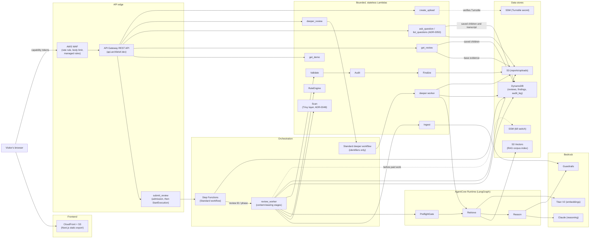

# ArchiBrief Architecture

This describes the source architecture; the [system walkthrough](system-walkthrough.md)
tells the same story as one review, with failure modes. Deployment checks are recorded separately;
reading this document does not establish that a particular revision is live.
Diagrams are Mermaid rather than
`mingrammer/diagrams` (ADR-0025's stated tool), which needs a local
Graphviz install; ADR-0025 calls its own choice "low-stakes, easily
revisited," so this is a documented substitution, not a reversal.

## System overview

## Review pipeline, step by step

1. **Submit** — after a Turnstile check, `create_upload` reserves an
   upload and returns a checksum-bound presigned PUT; the browser uploads
   the archive straight to S3, then calls `POST /reviews` with the
   archive's version, a workload brief and a repo reference.
   `submit_review` verifies the exact upload, reserves the review's
   estimated cost against the spending limits and starts the Step
   Functions execution.
2. **Dispatch and worker claim** — upload IDs are server-issued. Admission,
   immutable input binding and a stable Standard execution name prevent retries
   from starting another paid job. `review_worker` conditionally claims the
   review using the stored record; a later `poll` phase only reads status.
3. **Kill switch** — admission and the worker check the SSM switch before
   paid work. The worker loads content from `jobs/<review_id>/` in S3;
   Step Functions state carries identifiers/status, not briefs or findings.
4. **Ingest** — downloads the archive from S3, statically parses the
   Terraform with `python-hcl2` (never executes it), runs the content
   through Bedrock Guardrails.
5. **Scan** — runs Trivy (pinned, checksum-verified, shipped as a Lambda
   layer) over the uploaded Terraform in its own Lambda: no AWS
   credentials in its environment, HTTP(S) proxies pointed at a closed port (not an OS-level network sandbox), remote module sources
   rewritten before scanning, read-only access to `uploads/`. If it fails
   for any reason the review continues without it and says the scanner
   didn't run (ADR-0048).
6. **RuleEngine** — deterministic checks against the parsed Terraform,
   independent of any model call: Trivy's 17 trusted checks when Scan
   ran, plus ArchiBrief's own rules for what Trivy misses (and for
   everything, if Scan didn't run). It also builds a sanitized resource
   summary (allowlisted settings, documented defaults, values restricted
   to each setting's real formats) that Reason receives instead of the
   raw Terraform (ADR-0049). It adds fixed-vocabulary facts from nested
   configuration (`details`), environment and data-classification labels
   from tags (`declared_context`), and keeps the riskiest resources when a
   submission passes the 120-resource cap (ADR-0056, ADR-0059).
7. **PreflightGate → Retrieve → Reason** (AgentCore Runtime) — resolves
   per-field missing-data policy, retrieves relevant RAG chunks from S3
   Vectors (embedded via Titan V2) for the brief plus up to 8 risk and 2
   cost topic searches picked from the declared resource types (ADR-0057),
   and reasons over workload brief + rule findings + resource summary +
   retrieved evidence via Claude Sonnet 4.6. The prompt treats the brief's
   unverifiable claims as unverified; the brief can't narrow the review or
   lower a severity (ADR-0058).
   Guardrails runs again immediately before this step. No field pauses
   the review: the one that can't be inferred (regulatory and data
   residency requirements) is a required question on the submission form.
   The model call is one non-streaming request that waits up to 400 s for
   the whole answer (240 s for "go deeper") and is never retried. Bedrock
   holds a forced, strict tool call's output until it is complete, so a
   streamed call had nothing to show early (ADR-0059). The model reads
   observations in a compact form and at most 40 rule findings, one of each
   kind first. Model findings are capped at 12, the most severe kept.
   If this step fails, the worker publishes the rule and scanner findings
   on their own, marked `model_unavailable` in the analysis quality, instead
   of failing the review (ADR-0058).
8. **Validate** — schema-checks returned findings. Quote provenance is checked
   earlier in Reason against its retrieved chunks; Validate is not a second
   retrieval or semantic-support check. Rejected items are excluded, and the
   counts of attempted, accepted and rejected findings travel with the report
   as its analysis quality (`backend/shared/analysis_quality.py`), so a
   `complete` lifecycle is never read as complete analysis coverage.
9. **Audit → Finalize** — assembles the evidence ledger, persists it to
   S3, and updates the review's DynamoDB pointer item.
10. **Read results** — `GET /reviews/{reviewId}` returns the assembled
   report; `POST /reviews/{reviewId}/findings/{findingId}/deeper`
   re-invokes AgentCore (Retrieve → Reason(deep) → Validate) scoped to
   one finding, bypassing the rest of the pipeline entirely.
11. **Ask about it** — `POST /reviews/{reviewId}/questions` answers one
   question with a single Bedrock call over the stored review (findings
   under aliases, the resource summary, three retrieved WAF chunks, the
   last four turns), and the server keeps only what it can verify
   against the review. See `docs/chat.md`.

### The Stakeholder Brief: risk, proposed work and remaining exposure

ADR-0062 supersedes ADR-0051's price-oriented presentation. Findings appear in
severity order and expand to Risk, Work proposed, Helps prevent and Still exposed.
Commitment tiers are Light, Moderate, Major or Needs scoping; they are not dollar
estimates. Titles and harm statements must distinguish an explicit setting from
something merely not shown in the submitted files.

- Rule findings carry a concern and subject through
  `backend/shared/stakeholder/presentation.py`. The frontend's
  `lib/stakeholder-brief.ts` owns curated wording and tiers. Farm comparisons and
  scenes appear only where a curated rule concern has one.
- Model/reviewer plain-language summaries remain labelled by source and do not
  acquire a rule analogy. Unknown concerns use the technical summary fallback.
  Reviewer corrections remain beside their finding, including downloads.
- `backend/shared/money_policy.py` and the matching frontend policy remove price
  amounts from public chat answers (including cached answers) and downloads.
  Storage/evidence and legitimate Terraform references are preserved. Filtering
  output does not mean the chat model was instructed never to generate prices.
- Report metadata and assessments remain separate from display wording. Older
  reports and saved demo sidecars still load. Legacy pricing/recipe modules remain
  in the source for compatibility; their presence does not mean prices are shown.

See [current status](current-status.md) for the released brief, locally frozen
accuracy candidates, P2/P3b prerequisites and the limits of their evaluation.

`GET /demo` invokes a Lambda serving a precomputed reference report, without
starting a new review or model call. The three real demos load static frontend
files instead. Neither path is evidence of a fresh model execution.

## Asking for missing context up front

Reviews used to pause for up to 7 days (a `waitForTaskToken` state) when
preflight couldn't resolve a required field, and resume once the visitor
answered through `POST /reviews/{reviewId}/clarify`. Only the regulatory
and data-residency field ever paused, so the form now asks it before
submission, `submit_review` rejects a submission without it, and the
pause, the resume path and their Lambdas are gone (ADR-0054). Traffic and
availability still get explicit, labeled defaults (ADR-0031).

## Durable lifecycle and content-bearing work

Step Functions owns the outer lifecycle and outcome branching. A worker Lambda invokes content-bearing stages and publishes progress
to DynamoDB. It reads/writes full context in S3, keeping that content outside
new execution histories. The LangGraph PreflightGate → Retrieve → Reason graph
runs in AgentCore, called by the worker. Earlier executions retain their
historical definition/content; changing the source cannot erase old history.

Deeper HTTP admission dispatches its own Standard job, whose worker calls the shorter AgentCore graph with
the stored resource summary, settled requirements, and bounded parent evidence
and alternatives. Children and their completion marker commit together in
DynamoDB. Report GET and chat use the same projection of original S3 evidence
plus live, validated children. The report rebuilds the diagram and public presentation from that
projection, and the browser refreshes it after a deeper result is saved.
The S3 ledger stays unchanged. Output quality is recorded independently of job
completion; all-rejected deeper results are retained for free idempotent replay.
The HTTP handler never calls the model. Its durable worker permits one model
attempt and commits results with job completion; the browser recovers status on
reload. Job status is separate from retained-output quality. See the
[asynchronous contract](reviews/2026-10-23-async-deeper.md) and
[report redesign review](reviews/2026-10-23-report-redesign.md).

## Configuration observations and scope

Ingest preserves only provider Region configuration and bounded local module
bindings, never provider credentials. RuleEngine emits versioned typed facts and
direct relationships with known/absent/unknown/unsupported states and conditional
creation. Region/AZ details on diagrams use those same observations. The stored
summary flows to reasoning, deeper reviews and report chat; sanitized scope
limits accompany API reports and HTML/JSON exports. Chat discloses any detail it
omits under its context limit. See [coverage and explicit limits](terraform-coverage.md).

## Delivery

The frontend deploys itself: after a green `ci` run on `master`,
`deploy-frontend.yml` publishes that revision through a GitHub OIDC role
that can only write the site bucket and invalidate its distribution, then
checks the live build. A daily smoke workflow runs GET-only checks
(ADR-0055, [frontend deployment](frontend-deployment.md)). The backend is
not deployed by CI: the owner builds the Lambda and AgentCore packages
(`scripts/package_lambdas.py`, `backend/agent/build_runtime_package.py`),
reviews a `terraform plan` in `infra/environments/dev` and applies it.
