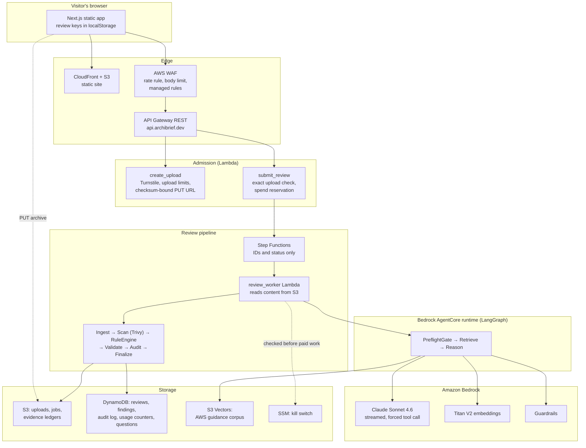
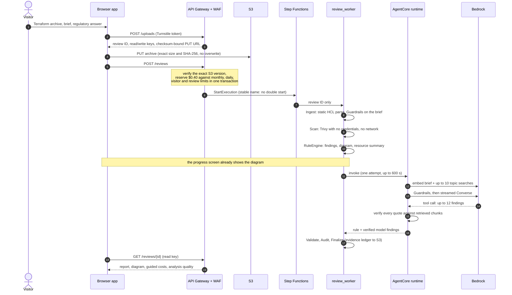
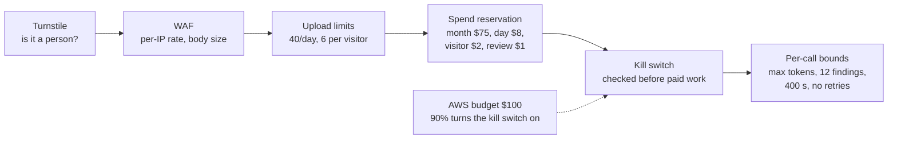
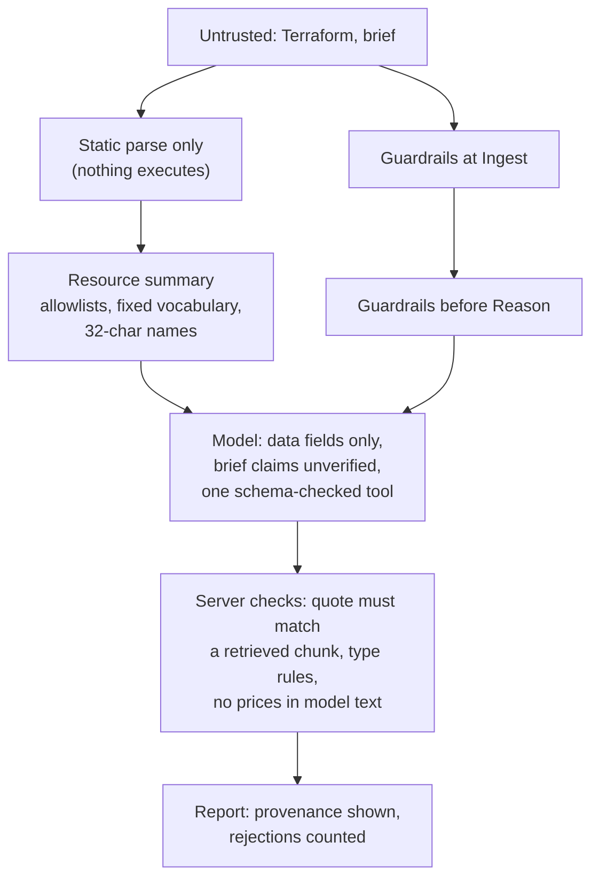

# System walkthrough: one review, end to end

A guided tour for someone seeing ArchiBrief for the first time: what happens
between "Start review" and the report, where each guarantee comes from, and
what happens when something fails. [Architecture](architecture.md) is the
reference; this is the story. Decision records are linked as ADR-NNNN.

## The shape of it

Seventeen single-purpose Lambdas, one Standard state machine, one AgentCore
runtime, six DynamoDB tables, four S3 buckets (review data, the site, two
deployment-artifact buckets) and an S3 Vectors index. Everything
is Terraform in `infra/`.

## A review, step by step

What each step guarantees:

| Step | Guarantee | Where |
|---|---|---|
| Upload | The bytes reviewed are exactly the bytes uploaded: size, SHA-256 and `If-None-Match: *` are signed into the URL | `backend/shared/uploads.py` |
| Submit | Money is reserved before any paid call, in one DynamoDB transaction across four scopes (month, day, visitor, review); a retry can't start a second run | `backend/shared/admission.py`, ADR-0052 |
| Workflow | Briefs and findings never enter Step Functions history; it carries IDs and status | ADR-0028 |
| Ingest | Terraform is parsed, never executed; remote modules are never fetched | ADR-0027 |
| Scan | Trivy runs boxed in: no AWS credentials, no network, module sources rewritten | ADR-0048 |
| RuleEngine | Deterministic findings that don't depend on the model or the brief | `backend/lambdas/rule_engine/` |
| Summary | The model gets facts, not code: allowlisted settings and fixed-vocabulary details, so no free text from the submission reaches it except capped names | ADR-0049, ADR-0056 |
| Reason | Every model quote must match a retrieved chunk; the model can only call `emit_findings` | ADR-0038 |
| Report | Rejected-output counts travel with the report; a rules-only report says so | `backend/shared/analysis_quality.py` |

## When things go wrong

| Failure | What the visitor sees | Why that's the right behavior |
|---|---|---|
| Turnstile fails or limits are reached | The form explains and nothing is charged | Fail closed before any cost |
| The archive is invalid | A clear failure; the reservation is given back | Nothing billed yet |
| Guardrails blocks the brief | "Flagged by our safety checks" | Guardrails was billed; the reservation stays |
| Trivy fails | The review continues with ArchiBrief's own rules and says the scanner didn't run | A scanner outage shouldn't block a review (ADR-0048) |
| The model fails or runs long | If the call fails or hasn't answered within 400 s, the review finishes with the rule findings and a note that the AI analysis didn't finish | Some evidence beats none; never retried, so never charged twice (ADR-0058, ADR-0059) |
| A model finding cites a quote that isn't in the evidence | That finding is dropped; the report counts it | One bad citation doesn't discard the review |
| Spend nears the monthly AWS budget | At 90% the kill switch turns itself on; every paid path refuses | Billing lags, so the $75 admission ceiling is the real-time limit (ADR-0052) |
| A deeper review times out | The job shows failed; reloading recovers its status | One model attempt per request |

## Cost control in layers

Each layer bounds a different failure: bots, floods, one visitor, one review,
an incident, a runaway call. Reservations are estimates, not a billing
ceiling; the AWS budget is the backstop for what admission doesn't see.

## Where the model is kept honest

No single layer is trusted to stop prompt injection. The structural ones
(nothing executes, no free text in the summary, no tool that changes
anything, server-side verification) hold even if the model is fooled
(ADR-0038, [threat model](threat-model.md)).

## Delivery

- **Frontend:** merge to `master` → CI → `deploy-frontend.yml` publishes
  that exact revision through an OIDC role that can only write the site
  bucket and invalidate CloudFront (ADR-0055). A daily smoke checks the live
  site with no credentials.
- **Backend:** the owner builds the Lambda and AgentCore packages, reviews a
  `terraform plan` and applies it. CI never touches backend infrastructure.
- **Quality gates on every PR:** backend tests (pytest and moto, including
  the trap and adversarial suites), frontend unit tests, Playwright with
  accessibility checks, Terraform lint and Trivy over our own infra, and
  Gitleaks.
