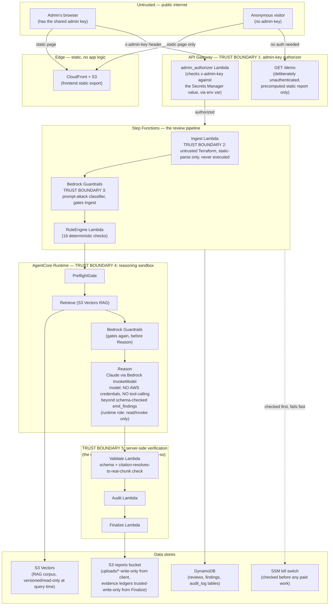

# ArchiBrief Threat Model

**Methodology**: STRIDE primary (trust-boundary / data-flow decomposition), OWASP Top 10 for LLM/GenAI as a completeness overlay — per [ADR-0041](adr/Work-Project-ADR-0041-Threat-Modeling-Methodology.md). Written against the real, deployed system as of 2026-10-13 (live at the frontend/API endpoints in the README), not the original design-phase intent — every control below is checked against actual code and, where noted, actual live-tested behavior, not assumed from an ADR's text alone.

**Diagram tooling note**: [ADR-0025](adr/Work-Project-ADR-0025-Diagram-Tooling-Interim.md) names `mingrammer/diagrams` for project diagrams, but that requires a local Graphviz install (`dot`), which this machine doesn't have. Rather than install a new system dependency to produce one diagram, the data-flow diagram below is Mermaid (renders natively in GitHub, GitLab, and Obsidian) — ADR-0025 itself calls this choice "low-stakes, easily revisited," so this is a substitution, not a reversal of that decision.

## Scope

**In scope**: the deployed ArchiBrief application — frontend (Next.js static export on S3/CloudFront), API Gateway + Lambda handlers, the Step Functions review pipeline, the AgentCore Runtime reasoning subworkflow (LangGraph: PreflightGate → Retrieve → Reason), Bedrock (Claude, Titan V2 embeddings, Guardrails), the S3 Vectors RAG corpus, and the DynamoDB/S3 data stores backing all of the above.

**Out of scope** (real limitations, not oversights):
- **Supply-chain security** of third-party dependencies (PyPI/npm packages, Terraform provider binaries) — covered by normal dependency hygiene (`gitleaks`, dependency pinning), not modeled as its own threat surface here.
- **AWS account/control-plane compromise** (stolen root credentials, IAM Identity Center compromise) — mitigated by standard account hygiene (root MFA'd and never used day-to-day, least-privilege deploy identity, permissions boundary — see [[Work-Project-Build-Plan]]) but not re-litigated here; this document assumes the AWS account itself is not already compromised.
- **Physical/endpoint security** of the admin's own workstation.
- **The product's own future diagram-generation feature** (deferred past v1, per ADR-0025/[[Work-Project-Spec]]).

## Data-flow diagram and trust boundaries

**The five trust boundaries, in words:**

1. **API Gateway admin-key authorizer** — the only real authentication boundary in the system (ADR-0044: no user accounts, one pre-shared credential). Every state-changing route sits behind it except `GET /demo`, which is deliberately public and unauthenticated by design (static precomputed content, zero pipeline cost, ADR-0029).
2. **Untrusted-Terraform ingestion contract** (ADR-0027) — the client-supplied Terraform archive is parsed with a static HCL parser (`python-hcl2`) and never executed, never shelled out to `terraform plan`/`apply`, never templated into a command string. This is the real control against a malicious archive, not sandboxing.
3. **Bedrock Guardrails at Ingest** — a prompt-attack classifier runs inline before the Terraform content (or any derived text) ever reaches a model.
4. **AgentCore Runtime's reasoning sandbox** — the model has no AWS credentials at all and no tool-calling surface beyond one schema-validated `emit_findings` call. The distinction matters: the *runtime* (the agent code AgentCore executes) does run under an IAM role, but every action on it is read/invoke-only — `bedrock:InvokeModel*`, `bedrock:ApplyGuardrail`, `bedrock:GetInferenceProfile`, `s3vectors:QueryVectors`/`GetVectors`, `s3:GetObject` on its own code-artifact bucket, and CloudWatch Logs. Model output can only influence what that code does through the validated `emit_findings` payload. Guardrails runs a second time immediately before this stage.
5. **Server-side verification, never trusting the model's own say-so** — every emitted finding is independently checked: schema validation, and for any finding type other than `not-observable`/`deterministic-rule-result`, the citation must resolve to a real retrieved chunk — a model self-labeling something `deterministic-rule-result` to dodge that check is explicitly rejected.

## Assets and data classes

| Asset | Sensitivity | Where it lives |
|---|---|---|
| Admin pre-shared key | High — sole authentication secret for the whole live app | Secrets Manager (`archibrief-dev-admin-key-*`), the Lambda authorizer's env var, the client's `sessionStorage` (tab-scoped, with a "Forget key" control) |
| Submitted Terraform archives | Medium — may describe a real AWS account's architecture | S3 `uploads/*` prefix, write-only from the client's presigned POST |
| Evidence ledgers (findings) | Medium — the review's actual output, could reveal architecture weaknesses if leaked | S3 reports bucket (Finalize-written only), DynamoDB `findings` table |
| Review/audit metadata | Low-medium | DynamoDB `reviews`/`audit_log` tables |
| RAG corpus (AWS WAF/security best-practice text) | Low — public AWS documentation, not sensitive on its own | S3 (source of truth) + S3 Vectors (query index) |
| Deploy-identity AWS credentials | High — compromise would allow infrastructure changes | IAM Identity Center SSO session on the admin's own workstation, never stored in the app |

## Attacker profiles

1. **Unauthenticated internet visitor.** Can reach the static frontend and `GET /demo` only. No login form exists to brute-force (the admin key is a header value, not a password prompt) — the only way to probe the gated surface is sending arbitrary `x-admin-key` guesses directly against the API, which API Gateway's per-route throttling limits (and, for `GET /demo` specifically, an isolated lower-throughput quota as of 2026-10-13 — see Work-Project-Issues-Log.md).
2. **Someone with a leaked or guessed admin key.** The realistic "worst case" external attacker — gets full access to the admin-gated API (submit reviews, trigger "go deeper," read results). Mitigated by: the key never being transmitted anywhere but this one app, no password-reset/recovery flow to abuse (there's no account to reset), and the architectural boundaries (3)-(5) above still applying regardless of who submitted the request.
3. **A malicious or adversarial Terraform repository submitted for review.** The threat model's actual primary design target, not a hypothetical — ADR-0027/0038 exist specifically because the content being reviewed is assumed untrusted even when the person submitting it is the legitimate admin (e.g. reviewing a client's or a third party's IaC). Covered by boundaries (2)-(5); prompt-injection regression tests for the reasoning node (`tests/backend/agent/nodes/test_reason.py`, stubbed model) run on every push/PR. The deterministic layer is weaker than that suggests: see the trap-suite gap under "Residual risks".
4. **A compromised or careless deploy identity** (e.g. the admin's own AWS SSO session). Out of full scope per this document's own boundaries above, but the project's least-privilege `ArchiBriefDeploy` permission set, its runtime permissions boundary (denies removing/swapping the boundary on any runtime role), and the explicit deny statements on the Terraform state bucket all reduce blast radius if this happens.

## Threat register (STRIDE, by trust boundary)

| # | Boundary | STRIDE category | Threat | Control | Status |
|---|---|---|---|---|---|
| T1 | 1 (admin-key authorizer) | Spoofing | Attacker guesses/brute-forces the admin key | 32-char `random_password`-generated secret; no feedback that distinguishes "wrong key" from "route doesn't exist"; per-route throttling | Mitigated. No lockout-after-N-attempts exists (there's no concept of a failed-login counter for a single shared key) — accepted residual risk given the key's length/randomness |
| T2 | 1 | Information disclosure | Admin key leaked via logs, client storage, or a referrer header | Never put in a URL/query string (checked: `requestHeaders` sends it as a custom header only); kept in `sessionStorage`, not a cookie, so it doesn't ride along on unrelated requests and is gone when the tab closes; a key left in `localStorage` by older builds is moved and deleted on load; "Forget key" clears it immediately | Mitigated for the app's own code paths. Residual risk: script running in the page (an XSS) or anyone at the open tab can read it — same risk class as any single shared credential |
| T3 | 1 | Denial of service | Public traffic (or a bot) exhausts the API's throttle quota | `GET /demo` isolated to its own lower-rate `route_settings` bucket (2026-10-13) so it can't starve admin-gated routes' quota | Partially mitigated — see T4 |
| T4 | 1 | Denial of service | A `/demo` traffic spike exhausts account-wide Lambda concurrency, indirectly starving the real pipeline's Lambdas | None currently — `lambda_reserved_concurrency` is `-1` (unreserved) because this account's concurrency ceiling is below AWS's 10-unreserved minimum to even set a reservation | **Open, accepted for now.** Needs either an AWS limit increase or `lambda:GetAccountSettings` access to confirm the real ceiling — tracked in Work-Project-Build-Plan.md |
| T5 | 2 (Terraform ingestion) | Tampering / elevation | Malicious Terraform content attempts to execute code via a crafted archive | Static `python-hcl2` parse only; no `subprocess`/`eval`/`exec` anywhere in the ingestion path (confirmed by direct grep, 2026-10-13 audit) | Mitigated |
| T6 | 2 | Tampering | Archive content attempts path traversal via a crafted S3 key | S3 keys have no `..`-resolution semantics; `review_id` validated against `^[A-Za-z0-9][A-Za-z0-9._-]{0,127}$` before being interpolated into any key | Mitigated |
| T7 | 3, 4 (Guardrails / reasoning sandbox) | Tampering | Prompt injection via Terraform comments/content, a workload brief, or a clarification note, attempting to override the reviewer's instructions | Guardrails at two points; `SYSTEM_PROMPT` explicitly labels retrieved content as untrusted data (added 2026-10-13); no AWS credentials or tool-calling surface available to a successfully-injected model; every finding independently re-verified downstream regardless | Mitigated, defense-in-depth (ADR-0038's own stated position: structural separation is the real boundary, labeling is a secondary layer) |
| T8 | 5 (server-side verification) | Repudiation / tampering | A model fabricates a citation or mislabels a finding type to dodge citation verification | `Finding`'s own `model_validator` enforces a citation for every non-`not-observable`/`deterministic-rule-result` type; citation must resolve to a real retrieved chunk, not just be well-formed | Mitigated |
| T9 | Data stores | Tampering | A DynamoDB write is built from unescaped user input (injection-style) | Every call uses the parameterized `Item`/`Key`/`ExpressionAttributeValues` API, including the direct-SDK `RecordStage*` ASL states added 2026-10-13 — confirmed no string-built expressions with interpolated user content exist anywhere in the codebase | Mitigated |
| T10 | Pipeline-wide | Denial of service (cost) | A real incident requires stopping all new paid work immediately | `/archibrief-dev/kill-switch` SSM parameter, checked before Ingest/RuleEngine/Bedrock ever run — **live-tested 2026-10-13**, confirmed zero paid work executes while active | Mitigated, tested |
| T11 | Pipeline-wide | Elevation of privilege | A compromised Lambda uses its execution role to reach beyond its own bounded task | Per-Lambda roles (one role per function, scoped to the data access that function's handler code uses) — audited 2026-10-13. A 2026-10-15 review found Audit and Finalize still sharing one policy (both tables, PutObject on the whole reports bucket); split in code to Audit = audit-table PutItem only, Finalize = reviews table + `reports/*` only | Mitigated in code; **live roles still have the shared policy until the next `terraform apply`** |
| T12 | Deploy identity | Elevation of privilege | The deploy identity's own `iam:CreateRole`/`PutRolePolicy` access is used to grant a runtime role more than it should have, or to strip its permissions boundary | `iam:CreateRole` conditioned on the exact runtime boundary being attached; explicit `Deny` on `DeleteRolePermissionsBoundary` and on `PutRolePermissionsBoundary` with any other boundary | Mitigated |

## OWASP Top 10 for LLM/GenAI — overlay

| OWASP category | Applies? | Control | Residual risk |
|---|---|---|---|
| LLM01 Prompt Injection | Yes — the primary AI-specific threat here | Guardrails (x2) + no-execution ingestion + no tool-calling/credentials + server-side citation verification (see T7) | Accepted, defense-in-depth is the stated posture (ADR-0038), not a claim of zero risk |
| LLM02 Insecure Output Handling | Yes | React's default JSX escaping (no `dangerouslySetInnerHTML`/`innerHTML` anywhere — confirmed by grep); findings rendered as structured typed fields, never raw HTML from the model | Mitigated |
| LLM03 Training Data Poisoning | No | Uses a pretrained foundation model (Claude via Bedrock); this project doesn't train or fine-tune | Not applicable |
| LLM04 Model Denial of Service | Partially | `max_tokens` wired through; AgentCore wall-clock bound added on the `InvokeAgent` Task state | Mitigated for a single request; account-wide concurrency risk tracked separately as T4 |
| LLM05 Supply Chain Vulnerabilities | Out of scope | Not modeled here (see Scope) | — |
| LLM06 Sensitive Information Disclosure | Partially | The model only ever sees `workload_brief`/`rule_findings`/retrieved RAG chunks — no raw credentials, no admin key, no other reviews' data passed into any prompt | Mitigated for the known data flows |
| LLM07 Insecure Plugin Design | Not applicable | No plugin architecture; the model's only "tool" is the schema-validated `emit_findings` output, which is itself independently re-verified | Not applicable |
| LLM08 Excessive Agency | Yes — directly relevant | The reasoning runtime has no AWS credentials, no mutating tool access of any kind (confirmed by reading `infra/modules/agentcore-runtime`'s IAM policy directly: every statement is read-only/invoke-only) | Mitigated by design |
| LLM09 Overreliance | Yes | Every finding carries a typed confidence score and confidence-input breakdown; `not-observable` is a first-class finding type specifically so the system can say "this cannot be determined" instead of guessing | Mitigated, though the confidence calibration itself (`_PRIORITY_BY_TYPE` in `backend/shared/report.py`) is explicitly flagged in its own code comment as a first-pass heuristic, not yet validated against real-world outcomes |
| LLM10 Model Theft | Not applicable | Uses a hosted foundation model via API; there's no proprietary model weights to steal | Not applicable |

## Abuse cases (concrete scenarios, not abstract categories)

- **"I found the demo URL and I'm hammering it with a script."** → Hits the isolated `GET /demo` throttle bucket (T3), gets `429`s; worst case if that's somehow exceeded account-wide is Lambda concurrency pressure (T4, open).
- **"I have the admin key (leaked or shared) and I submit a Terraform repo containing a prompt injection in a `#` comment."** → Guardrails at Ingest likely flags it; even if it slips through, the model that reads it has no credentials and no tool access, and any finding it tries to fabricate still needs a real, resolvable citation to survive Validate (T7, T8).
- **"I submit an archive with a path like `../../etc/passwd` as a filename inside the tarball."** → S3 keys don't resolve `..`, and `review_id` (the only client-controlled piece of the actual S3 key) is pattern-validated before use (T6).
- **"I trigger 'go deeper' on a finding from a review finalized before `workload_brief` was persisted."** → Explicitly handled, not a silent failure: `deeper_review.handler` returns a `409` with a clear error rather than sending an empty brief to the model.
- **"Something's actively wrong in production and I need to stop all spend right now."** → Flip `/archibrief-dev/kill-switch` to `true`; live-tested 2026-10-13, confirmed sub-second fail-fast with zero Ingest/Bedrock/AgentCore invocation (T10).

## Test evidence (real, not aspirational)

- As of 2026-10-15: 307 passing backend tests (`pytest`; 4 of them skip when the gitignored corpus data is absent) plus 17 strict-`xfail` trap cases documenting known rule-engine gaps; 29 frontend unit tests (Vitest); 3 Playwright E2E tests against a mocked network. All run in CI on every push/PR.
- Prompt-injection regression tests for the reasoning node (`tests/backend/agent/nodes/test_reason.py`) run in CI against a stubbed model — they prove the prompt structure and verification path, not real-model behavior. Real-model trap briefs (`backend/agent/trap_eval.py`) are paid and run manually.
- A real retrieval-quality baseline exists against the live RAG index: 89% Hit Rate@5 (dev set), 86% (held-out set) — see Work-Project-Issues-Log.md, 2026-10-13.
- The kill switch (T10) and the per-Lambda IAM least-privilege claim (T11) were both verified live against the real deployment, not just by reading code — both 2026-10-13.

## Residual risks, explicitly accepted (not silently ignored)

1. **T4** — Lambda account-wide concurrency isn't reserved for the real pipeline, because this AWS account's concurrency ceiling is apparently below AWS's own 10-unreserved minimum to set a reservation at all. Accepted for now; revisit once the real ceiling is confirmed (blocked on `lambda:GetAccountSettings` access) or raised.
2. **No lockout on repeated wrong admin-key attempts (T1)** — there's no concept of a failed-attempt counter for a single shared credential; accepted given the key's length/randomness and that this isn't a multi-tenant login system.
3. **CI is advisory, not a blocking merge gate** — this repo is private and not on GitHub Pro, so branch-protection required-status-checks aren't available. Every test suite described above genuinely runs on every push regardless; what's missing is CI *blocking* a merge if they fail. Accepted until the repo goes public (already planned) or a Pro upgrade happens.
4. **Finding-priority calibration (OWASP LLM09 overlay)** is a documented first-pass heuristic, not validated against real-world outcomes yet — accepted as a known v1 limitation, not hidden.
5. **Rule-engine trap gaps** — the 2026-10-15 trap suite (`tests/backend/traps/`) showed the deterministic rule engine missed all 14 dangerous-but-sneaky Terraform configs and flagged 3 of 4 safe red herrings. Because the model never sees Terraform, a pattern the rule engine misses is invisible to the whole pipeline. Recorded as 17 strict `xfail` cases; open, not accepted long-term.
6. **"Go deeper" timeout** — synchronous behind the HTTP API's 30 s integration limit; the agent call is capped at ~24 s and a per-finding in-flight claim plus stored-result reuse stop retries from double-spending. A longer analysis returns a timeout error rather than running async.

## Appendix: NIST AI RMF (Generative AI Profile) overlay

Optional per ADR-0041 — included to show risk ownership, measurement,
and lifecycle thinking, deliberately kept lightweight rather than
turning a solo project into a compliance program. Mapped against NIST
AI RMF's four core functions, using only what's actually true of this
project today.

**GOVERN** — who owns AI risk decisions and how they get made.
- Single owner, no committee: Fernando is the sole admin and sole
  decision-maker (ADR-0044: no user accounts). Every architectural
  decision affecting AI risk is recorded as an immutable ADR before
  being treated as locked (ADR-0026).
- Risk decisions aren't private judgment calls — they're written down
  with reasoning, re-checked against real code/test evidence when
  revisited (this threat model's own "Mitigated"/"tested" claims are
  an example), and residual risks are recorded as *accepted*, not
  silently dropped (see "Residual risks" above).

**MAP** — identifying context, use case, and risk sources.
- Use case is explicitly bounded: a *second opinion* on AWS
  architecture, not an autonomous agent that modifies infrastructure
  (ADR-0002) — the reasoning runtime has zero mutating AWS permissions
  by design (LLM08 row above), which caps the blast radius of most
  AI-specific risk categories before they can even manifest.
  Attacker profiles and the primary AI-specific risk (prompt
  injection via untrusted Terraform/workload-brief content) are mapped
  explicitly in this document's "Attacker profiles" and T7/LLM01 rows,
  not left implicit.

**MEASURE** — testing, metrics, and real evidence, not assumed quality.
- Every finding carries a typed confidence score and a confidence-input
  breakdown (evidence directness, source agreement, rule determinism) —
  the system measures its own certainty rather than presenting every
  output as equally trustworthy.
- Retrieval quality has a real, measured baseline: 89% Hit Rate@5 (dev
  set), 86% (held-out set), against the live RAG index — not an
  assumed-good embedding choice (Work-Project-Issues-Log.md,
  2026-10-13).
- Prompt-injection regression tests for the reasoning node run on
  every push/PR against a stubbed model
  (`tests/backend/agent/nodes/test_reason.py`), and a deterministic
  trap suite (`tests/backend/traps/`) tracks rule-engine gaps as strict
  `xfail` cases. Real-model trap briefs are paid and run manually.
- The kill switch — the main lever for stopping runaway model-driven
  spend — was live-tested against the real deployment, not just
  code-reviewed.

**MANAGE** — responding to and prioritizing identified risks.
- Every open/residual risk in this document has an explicit priority
  and an explicit reason it's accepted rather than fixed (see
  "Residual risks"), cross-referenced into Work-Project-Build-Plan.md
  so it isn't only visible here.
- The kill switch exists specifically as a MANAGE-function control:
  a fast, tested way to stop new AI-driven spend during an active
  incident without waiting on AWS Budgets' own (non-real-time) alerting.
- Findings are never auto-applied to a real AWS account — ArchiBrief
  only ever reports; a human (the admin) decides what to act on. This
  is itself a risk-management decision (ADR-0002), not an accident of
  scope.

**Deliberately not attempted**: formal AI risk measurement cadences,
third-party audits, or a documented model card for the underlying
Claude model (Anthropic's own responsibility, not reproduced here).
This appendix maps existing practice to the NIST framework's vocabulary
— it does not claim compliance with a formal AI risk management
program.

## Change log

| Date | Change |
|---|---|
| 2026-10-13 | Initial version, written against the live deployed system following a full manual security audit, a per-Lambda IAM audit, a live kill-switch test, and a real retrieval-evaluation baseline run — all performed the same day this document was written, so every "Mitigated"/"tested" claim above reflects same-day verification, not inherited assumptions. |
| 2026-10-14 | Added the optional NIST AI RMF governance appendix (ADR-0041). |
| 2026-10-15 | Corrected after a code review: model vs runtime credentials, admin key now in `sessionStorage`, T11 (shared Audit/Finalize policy found and split, pending apply), current test counts incl. E2E, trap-suite and "go deeper" timeout added as residual risks, authorizer key source. |
