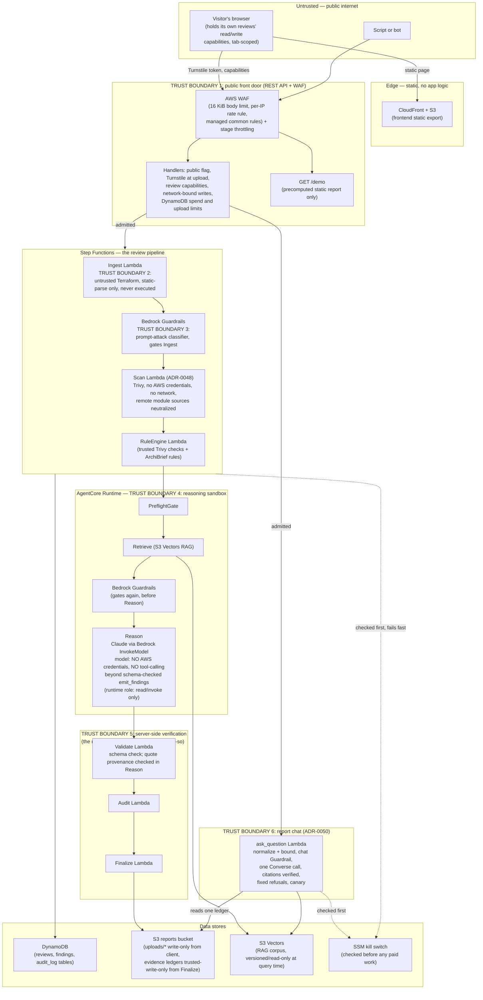

# ArchiBrief Threat Model

**Methodology**: STRIDE primary (trust-boundary / data-flow decomposition), OWASP Top 10 for LLM/GenAI as a completeness overlay — per [ADR-0041](adr/0041-threat-modeling-methodology.md). Controls describe the source design; deployed checks require separate evidence and are identified where recorded. A source review or ADR alone does not establish live enforcement.

**Publication limits:** Reason checks quote provenance; Validate schema-checks
its results. Neither proves semantic support. The local redesign preserves
rejected-output counters through publication; lifecycle `complete` still does
not mean complete analysis. Risk/action assessments are independent of evidence
labels. Bounded configuration observations disclose unknowns and omissions. Demo
corrections now accompany downloads and saved answers; the original model text
is preserved and the answers have not been regenerated. Deeper reviews now use
identifier-only durable jobs and atomic child results, assembled with immutable
S3 evidence by report/chat consumers. No paid retry is automatic. These are
source controls pending independent review and deployed verification; see
[async contract](reviews/2026-10-23-async-deeper.md) and [coverage](terraform-coverage.md).

**Diagram tooling note**: [ADR-0025](adr/0025-diagram-tooling-interim.md) names `mingrammer/diagrams` for project diagrams, but that requires a local Graphviz install (`dot`). Rather than add a system dependency for one diagram, the data-flow diagram below is Mermaid (renders natively on GitHub and GitLab) — ADR-0025 itself calls this choice "low-stakes, easily revisited," so this is a substitution, not a reversal of that decision.

## Scope

**In scope**: the deployed ArchiBrief application — frontend (Next.js static export on S3/CloudFront), API Gateway + Lambda handlers, the Step Functions review pipeline, the AgentCore Runtime reasoning subworkflow (LangGraph: PreflightGate → Retrieve → Reason), Bedrock (Claude, Titan V2 embeddings, Guardrails), the S3 Vectors RAG corpus, and the DynamoDB/S3 data stores backing all of the above.

**Out of scope** (real limitations, not oversights):
- **Supply-chain security** of third-party dependencies (PyPI/npm packages, Terraform provider binaries) — covered by normal dependency hygiene (`gitleaks`, dependency pinning), not modeled as its own threat surface here.
- **AWS account/control-plane compromise** (stolen root credentials, IAM Identity Center compromise) — mitigated by standard account hygiene (root MFA'd and never used day-to-day, least-privilege deploy identity, permissions boundary) but not re-litigated here; this document assumes the AWS account itself is not already compromised.
- **Physical/endpoint security** of the admin's own workstation.
- **Model-generated diagrams** (deferred per ADR-0025). The report's architecture diagram is built deterministically from the parsed Terraform, with no model involved.

## Data-flow diagram and trust boundaries

**The six trust boundaries, in words:**

1. **The public front door** — there are no user accounts, so nothing here authenticates a person. A Regional REST API stage behind AWS WAF (body limit, per-IP rate rule, AWS managed common rules) and stage throttling takes every request. Each handler then enforces the rest itself: the public-access flag, a Cloudflare Turnstile check before an upload is granted, per-review read/write capabilities (random tokens whose hashes are stored; writes also need the original network identifier), and DynamoDB transactions that reserve estimated spend against global, per-visitor and per-review limits before any paid work. `GET /demo` serves a precomputed report and needs nothing (ADR-0029).
2. **Untrusted-Terraform ingestion contract** (ADR-0027) — the client-supplied Terraform archive is parsed with a static HCL parser (`python-hcl2`) and never executed, never shelled out to `terraform plan`/`apply`, never templated into a command string. This is the real control against a malicious archive, not sandboxing.
3. **Bedrock Guardrails at Ingest** — a prompt-attack classifier runs inline before the Terraform content (or any derived text) ever reaches a model.
4. **AgentCore Runtime's reasoning sandbox** — the model itself holds no AWS credentials and has no tool-calling surface beyond one schema-validated `emit_findings` call. The distinction matters: the *runtime* (the agent code AgentCore executes) does run under an IAM role, but every action on it is read/invoke-only — `bedrock:InvokeModel*`, `bedrock:ApplyGuardrail`, `bedrock:GetInferenceProfile`, `s3vectors:QueryVectors`/`GetVectors`, `s3:GetObject` on its own code-artifact bucket, and CloudWatch Logs. Model output can only influence what that code does through the validated `emit_findings` payload. Guardrails runs a second time immediately before this stage.
5. **Server-side verification, never trusting the model's own say-so** — every emitted finding is independently checked: schema validation, and for any finding type other than `not-observable`/`deterministic-rule-result`, the citation must resolve to a real retrieved chunk — a model self-labeling something `deterministic-rule-result` to dodge that check is explicitly rejected.
6. **The report chat** (ADR-0050) — a visitor's question is untrusted, and so is everything the chat model reads (the stored brief and findings were written from untrusted input). Questions are normalized and bounded, screened by a chat-only Guardrail (fail closed), and answered by one model call whose output the server checks citation by citation; refusals are fixed text. The Lambda's role can invoke only the chat models and read only `reports/*`; it has no write access to reviews beyond its own counters and question records. Asking needs the review's write capability.

## Assets and data classes

| Asset | Sensitivity | Where it lives |
|---|---|---|
| Review capabilities (read/write tokens) | Medium — whoever holds a review's tokens can read it, and with the original network, act on it | Issued once at upload; only SHA-256 hashes stored in DynamoDB; the client keeps them in tab `sessionStorage` |
| Turnstile secret, visitor-hash and reservation keys | Medium — would let an attacker skip the bot check or forge identifiers | SSM SecureString (Turnstile); Terraform-generated Lambda environment values (hash and reservation keys) |
| Submitted Terraform archives | Medium — may describe a real AWS account's architecture | S3 `uploads/*` prefix, written by the client through a checksum-bound, no-overwrite presigned PUT |
| Evidence ledgers (findings) | Medium — the review's actual output, could reveal architecture weaknesses if leaked | S3 reports bucket (Finalize-written only), DynamoDB `findings` table |
| Review/audit metadata | Low-medium | DynamoDB `reviews`/`audit_log` tables |
| RAG corpus (AWS WAF/security best-practice text) | Low — public AWS documentation, not sensitive on its own | S3 (source of truth) + S3 Vectors (query index) |
| Deploy-identity AWS credentials | High — compromise would allow infrastructure changes | IAM Identity Center SSO session on the admin's own workstation, never stored in the app |

## Attacker profiles

1. **Anonymous internet visitor.** Can do everything the site offers: submit within the daily limits, clarify, go deeper and ask questions about their own reviews. Can't read or act on anyone else's review without that review's tokens. The architectural boundaries (2)-(5) apply to every submission.
2. **A script trying to burn the budget or the daily capacity.** Turnstile, WAF, stage throttling and transactional global/visitor/review reservations constrain admitted work. An attacker can exhaust the day's capacity. Reservations estimate cost; they are not an AWS billing ceiling and do not bound every infrastructure charge.
3. **A malicious or adversarial Terraform repository submitted for review.** The threat model's actual primary design target, not a hypothetical — ADR-0027/0038 exist specifically because the content being reviewed is assumed untrusted, whoever submits it (e.g. a client's or a third party's IaC). Covered by boundaries (2)-(5); prompt-injection regression tests for the reasoning node (`tests/backend/agent/nodes/test_reason.py`, stubbed model) run on every push/PR. The deterministic layer is weaker than that suggests: see the trap-suite gap under "Residual risks".
4. **A compromised or careless deploy identity** (e.g. the admin's own AWS SSO session). Out of full scope per this document's own boundaries above, but the project's least-privilege `ArchiBriefDeploy` permission set, its runtime permissions boundary (denies removing/swapping the boundary on any runtime role), and the explicit deny statements on the Terraform state bucket all reduce blast radius if this happens.

## Threat register (STRIDE, by trust boundary)

| # | Boundary | STRIDE category | Threat | Control | Status |
|---|---|---|---|---|---|
| T1 | 1 (front door) | Spoofing | A script gets uploads or reviews without a person behind it | Turnstile verified server-side (success, hostname, action) before an upload grant, failing closed; per-visitor and global upload and spend limits; WAF per-IP rate rule | Mitigated within the limits. A paid CAPTCHA-solving service could pass Turnstile; the spend limits still bound the cost |
| T2 | 1 | Information disclosure | Someone reads or changes another visitor's review | 32+ character random read/write tokens, only hashes stored; writes also require the original network identifier; review IDs are server-issued; tokens never go in URLs (`requestHeaders` sends them as headers) and live in tab `sessionStorage` | Mitigated. Residual: script in the page (an XSS) or anyone at the open tab can read them; a shared read token works for whoever has it |
| T3 | 1 | Denial of service | Traffic (or a bot) exhausts the API's throttle quota or the day's review capacity | WAF per-IP rate rule (429); stage throttling, with `GET /demo` and chat questions on their own lower per-method limits; daily limits sized to the budget | Partially mitigated: a bot inside the limits can still use up the day's reviews (see T4) |
| T4 | 1 | Denial of service | A `/demo` traffic spike exhausts account-wide Lambda concurrency, indirectly starving the real pipeline's Lambdas | None currently — `lambda_reserved_concurrency` is `-1` (unreserved) because this account's concurrency ceiling is below AWS's 10-unreserved minimum to even set a reservation | **Open, accepted for now.** Needs either an AWS limit increase or `lambda:GetAccountSettings` access to confirm the real ceiling |
| T5 | 2 (Terraform ingestion) | Tampering / elevation | Malicious Terraform content attempts to execute code via a crafted archive | Ingest: static `python-hcl2` parse only, no `subprocess`/`eval`/`exec`. Scan (ADR-0048) is the one documented exception: it runs the pinned, checksum-verified Trivy binary as a subprocess on the already-vetted files. Trivy evaluates HCL statically and never runs terraform, providers or provisioners; it runs with no AWS credentials in its environment, in its own Lambda whose role can only read `uploads/` | Mitigated |
| T6 | 2 | Tampering | Archive content attempts path traversal via a crafted S3 key | S3 keys have no `..`-resolution semantics; `review_id` validated against `^[A-Za-z0-9][A-Za-z0-9._-]{0,127}$` before being interpolated into any key | Mitigated |
| T7 | 3, 4 (Guardrails / reasoning sandbox) | Tampering | Prompt injection via Terraform comments/content, a workload brief, or a clarification note, attempting to override the reviewer's instructions | Guardrails at two points; `SYSTEM_PROMPT` explicitly labels retrieved content as untrusted data; no mutating tool available to a successfully-injected model, and the runtime role is read/invoke-only; every finding independently re-verified downstream regardless | Mitigated, defense-in-depth (ADR-0038's own stated position: structural separation is the real boundary, labeling is a secondary layer) |
| T8 | 5 (server-side verification) | Repudiation / tampering | A model fabricates a citation or mislabels a finding type to dodge citation verification | `Finding`'s own `model_validator` enforces a citation for every non-`not-observable`/`deterministic-rule-result` type; citation must resolve to a real retrieved chunk, not just be well-formed | Mitigated |
| T9 | Data stores | Tampering | A DynamoDB write is built from unescaped user input (injection-style) | Every call uses the parameterized `Item`/`Key`/`ExpressionAttributeValues` API, including the direct-SDK `RecordStage*` ASL states — confirmed no string-built expressions with interpolated user content exist anywhere in the codebase | Mitigated |
| T10 | Pipeline-wide | Denial of service (cost) | A real incident requires stopping all new paid work immediately | `/archibrief-dev/kill-switch` SSM parameter, checked before Ingest/RuleEngine/Bedrock ever run — **tested on the live deployment**, confirmed zero paid work executes while active | Mitigated, tested |
| T11 | Pipeline-wide | Elevation of privilege | A compromised Lambda uses its execution role to reach beyond its own bounded task | Per-Lambda roles (one role per function, scoped to the data access that function's handler code uses), audited against the deployment. Audit and Finalize have separate policies: Audit = audit-table PutItem only, Finalize = reviews table + `reports/*` only | Mitigated |
| T13 | 2 (Scan) | Spoofing / SSRF | Submitted Terraform names a remote module (`git::`, registry, `s3::`, HTTP) so the scanner fetches an attacker-chosen URL from our account — Trivy does download remote modules by default | Every non-local `source` is rewritten before scanning; local sources escaping the archive are rewritten too; Trivy's HTTP(S) proxies point at a closed local port; no AWS credentials in its environment, so an `s3::` source can't use ours | Mitigated, unit-tested |
| T14 | 3, 4 | Tampering | Instruction text smuggled into what the reasoning model reads: a resource name inside rule-finding text (trap c02), or a setting value or name in the resource summary (ADR-0049) | Names and string setting values are restricted to identifier characters and capped at 32 characters; summary settings come only from an allowlist and are otherwise booleans, numbers, "not set" or "unknown"; comments, descriptions, tags and policy text never reach the model; the prompt frames all of it as untrusted data; findings are re-verified downstream | Mitigated (defense in depth); model-side trap briefs cover the rest |
| T15 | 6 (report chat, ADR-0050) | Tampering | Prompt injection through a chat question, the stored brief or finding text, a resource name, or earlier turns, to make the chat say something false, reveal its instructions or act as a general assistant | Stage 1–2: NFKC, invisible/tag characters stripped, mixed-script words and base64 payloads rejected, 500-char cap. Stage 3: a chat-only Guardrail (prompt attack + three narrow denied topics), fail closed. Stage 4: all untrusted text only in JSON data fields; history is loaded server-side (a body with any unknown field, e.g. a forged `history`, is a 400). Stage 5: every paragraph must cite something the server can verify, refusals become fixed text, a per-deploy canary turns any leak into a refusal. 31-case trap suite, stubbed in CI | Mitigated, defense in depth; real-model trap run pending (paid) |
| T16 | 6 | Information disclosure | The chat cites or reveals another review's findings or data | The model sees findings only under per-review aliases (F1…), never UUIDs; an alias not in this review's map can't resolve; the handler loads exactly one ledger by path parameter; the role reads only `reports/*` | Mitigated by construction, unit-tested |
| T17 | 6 | Denial of service (cost) | Questions used to run up model spend: many questions, retries, long answers, parallel first clicks on a suggestion | Kill switch first; per-review 5-question slot, the day's worst-case $ reservation and a question count, all in one DynamoDB transaction before the paid call; `maxTokens` 700 and an 1,800-char cap; idempotent `client_request_id`; in-flight locks on questions and suggestions; per-method throttling 2 req/s; failed calls refund the slot but keep the $ reservation | Mitigated, moto-tested; the daily cap's value is set from measured cost |
| T18 | 6 | Information disclosure | Question or answer text, or a blocked attack, ends up in logs | One allowlisted JSON log line per request with counts, tokens and cost only; a blocked question logs a SHA-256, never its text; 7-day log retention | Mitigated, tested on captured stdout |
| T12 | Deploy identity | Elevation of privilege | The deploy identity's own `iam:CreateRole`/`PutRolePolicy` access is used to grant a runtime role more than it should have, or to strip its permissions boundary | `iam:CreateRole` conditioned on the exact runtime boundary being attached; explicit `Deny` on `DeleteRolePermissionsBoundary` and on `PutRolePermissionsBoundary` with any other boundary | Mitigated |

## OWASP Top 10 for LLM Applications (2025 edition) — overlay

Mapped against the [2025 edition](https://genai.owasp.org/llm-top-10/). Earlier versions of this table used the 2023 numbering (LLM02 output handling, LLM03 training data poisoning, LLM08 excessive agency); the 2025 edition renumbers those and adds system prompt leakage, vector and embedding weaknesses, and unbounded consumption.

| OWASP 2025 category | Applies? | Control | Residual risk |
|---|---|---|---|
| LLM01:2025 Prompt Injection | Yes — the primary AI-specific threat here | Guardrails (x2) + no-execution ingestion + no mutating tool for the model + server-side citation verification (see T7) | Accepted, defense-in-depth is the stated posture (ADR-0038), not a claim of zero risk |
| LLM02:2025 Sensitive Information Disclosure | Partially | The model only ever sees `workload_brief`/`rule_findings`/retrieved RAG chunks and ADR-0049's sanitized resource summary — no raw Terraform, credentials or other reviews' data. The chat model sees the same summary plus this one review's stored findings (T16) | Mitigated for the known data flows |
| LLM03:2025 Supply Chain | Partially | Hosted foundation model via Bedrock (no third-party weights or adapters). npm dependencies are locked (`package-lock.json`, `npm ci`); the Lambda and AgentCore packages install from pinned versions (`scripts/lambda_constraints.txt`, `backend/agent/runtime_requirements.lock.txt`); Dependabot proposes updates; Trivy is a checksum-verified release | Not modeled in depth (see Scope). CI's own Python test install isn't pinned, and no CI job scans dependencies for known vulnerabilities |
| LLM04:2025 Data and Model Poisoning | Yes, for the RAG corpus | No training or fine-tuning. The corpus is built by the site owner from a fixed list of AWS documentation URLs (`backend/corpus/ingest.py`), versioned (`corpus_version`), and each chunk carries a content hash that every citation must match. Users can't add documents | A changed or compromised upstream AWS page would be ingested on the next rebuild; there is no review of corpus diffs between versions. Accepted for a single-owner corpus |
| LLM05:2025 Improper Output Handling | Yes | React's default JSX escaping (no `dangerouslySetInnerHTML`/`innerHTML` anywhere — confirmed by grep); findings rendered as structured typed fields, never raw HTML from the model. Chat answers: URLs and markdown links stripped server-side, source links only from the server's own citation records and only `https:`; the downloaded report is built from escaped text with no scripts (unit-tested against `<script>` and `javascript:` inputs) | Mitigated |
| LLM06:2025 Excessive Agency | Yes — directly relevant | The model has no tool that can change anything: its only output is the schema-validated `emit_findings` payload. The runtime that hosts it does run under an IAM role, and that role is read/invoke-only (`infra/modules/agentcore-runtime`: Bedrock invoke and Guardrails, S3 Vectors query/get, `s3:GetObject` on its own code bucket, CloudWatch Logs) | Mitigated by design. This is "no mutating capability", not "no credentials": a compromise of the runtime code itself would act with that role |
| LLM07:2025 System Prompt Leakage | Low impact | The system prompts hold instructions only — no secrets, keys, access rules or other users' data — and are in the repository. Authorization is enforced server-side, never by the prompt | Accepted: leaking a prompt reveals nothing that isn't already in the code |
| LLM08:2025 Vector and Embedding Weaknesses | Partially | One S3 Vectors index holding only the owner-built AWS corpus; no user content is embedded, so there is no cross-tenant retrieval. The runtime role can query but not write vectors | Embedding inversion and access-control mixing don't apply while no user data is embedded; revisit if that changes |
| LLM09:2025 Misinformation | Yes | Every finding carries a type, a confidence breakdown and its evidence; `not-observable` lets the system say "can't tell" instead of guessing; quotes must match retrieved chunks word for word | **A verified citation proves the passage exists, not that it supports the conclusion.** An outside review (October 2026) found rule and hand-written text that overstated what the code shows (S3 default encryption, CloudTrail coverage, IAM database authentication logging); see [demos.md](demos.md). Risk/action assessments are separate from evidence provenance and confidence; calibration is not validated against outcomes |
| LLM10:2025 Unbounded Consumption | Yes | `max_tokens` and an AgentCore wall-clock bound on each request; every paid path reserves estimated cost against global, per-visitor and per-review limits in one DynamoDB transaction before the call; chat also has its own daily cap (ADR-0050); a kill switch and budget alerts | Reservations are estimates, not an AWS billing ceiling, and are not settled to actual review cost; budget alerts notify rather than stop spending |

## Abuse cases (concrete scenarios, not abstract categories)

- **"I found the demo URL and I'm hammering it with a script."** → Hits the WAF rate rule and `GET /demo`'s own throttle (T3), gets `429`s; worst case if that's somehow exceeded account-wide is Lambda concurrency pressure (T4, open).
- **"I submit a Terraform repo containing a prompt injection in a `#` comment."** → Guardrails at Ingest likely flags it; even if it slips through, the model that reads it has no tool that can change anything, and any finding it tries to fabricate still needs a real, resolvable citation to survive Validate (T7, T8).
- **"I submit an archive with a path like `../../etc/passwd` as a filename inside the tarball."** → S3 keys don't resolve `..`, and `review_id` (the only client-controlled piece of the actual S3 key) is pattern-validated before use (T6).
- **"I trigger 'go deeper' on a finding from a review finalized before `workload_brief` was persisted."** → Explicitly handled, not a silent failure: `deeper_review.handler` returns a `409` with a clear error rather than sending an empty brief to the model.
- **"I ask the chat to ignore its rules, in fullwidth letters split by zero-width spaces."** → Stage 1 turns it back into plain words (or rejects it, for lookalike letters or base64), the chat Guardrail then sees "ignore your rules"; if the model still complies, its uncited text is dropped and a fixed "not determinable" answer is returned (T15).
- **"I script 1,000 chat questions against one review."** → The review's 5 slots and the day's $ reservation stop paid calls before Bedrock is reached, and per-method throttling and the WAF rate rule slow the script (T17).
- **"Something's actively wrong in production and I need to stop all spend right now."** → Flip `/archibrief-dev/kill-switch` to `true`; tested on the live deployment, confirmed sub-second fail-fast with zero Ingest/Bedrock/AgentCore invocation (T10).

## Test evidence (real, not aspirational)

- Backend tests (`pytest`; a few skip when the gitignored corpus data is absent, plus the deterministic trap suite), frontend unit tests (Vitest) and Playwright E2E tests against a mocked network all run in CI on every push/PR. Current counts are in [evaluation.md](evaluation.md).
- Prompt-injection regression tests for the reasoning node (`tests/backend/agent/nodes/test_reason.py`) run in CI against a stubbed model — they prove the prompt structure and verification path, not real-model behavior. Real-model trap briefs (`backend/agent/trap_eval.py`) are paid and run manually.
- A real retrieval-quality baseline exists against the live RAG index: 89% Hit Rate@5 (dev set), 86% (held-out set).
- The kill switch (T10) and the per-Lambda IAM least-privilege claim (T11) were both verified against the real deployment, not just by reading code.

## Residual risks, explicitly accepted (not silently ignored)

1. **T4** — Lambda account-wide concurrency isn't reserved for the real pipeline, because this AWS account's concurrency ceiling is apparently below AWS's own 10-unreserved minimum to set a reservation at all. Accepted for now; revisit once the real ceiling is confirmed (blocked on `lambda:GetAccountSettings` access) or raised.
2. **The day's capacity can be used up (T1, T3)** — a determined script that passes Turnstile can take the few daily reviews, so real visitors see "try again tomorrow". Accepted: it bounds cost, and the kill switch and limits can be tuned.
3. **Reservations are estimates** — review reservations are fixed per operation and not settled to the actual Bedrock bill, so real spend can differ from the limits by the ratio of real to estimated cost. Measured per-review cost sets the reservation values.
4. **Risk/action assessment calibration (OWASP LLM09:2025 overlay)** is a documented first-pass heuristic, not validated against real-world outcomes yet — accepted as a known v1 limitation, not hidden.
5. **Deterministic coverage is bounded by the trap suite** — the trap suite (`tests/backend/traps/`) first showed the rule engine missed all 14 dangerous-but-sneaky configs and flagged 3 of 4 safe ones; Trivy plus rebuilt rules (ADR-0048) now catch 14/14 with 0/4 false positives, with and without Trivy. The model sees bounded configuration observations, which cover more settings than findings alone. Unsupported or omitted fields remain unobserved; no arbitrary-Terraform recall is established. See [coverage](terraform-coverage.md).
6. **"Go deeper" timeout** — HTTP admission dispatches an identifier-only Standard workflow. A separate worker permits one model attempt and atomically saves job completion plus children. Polling/reload recover saved outcomes; an uncertain client timeout preserves the last server status. Failure/timeout never automatically purchases another model attempt. Deployment and failure-injection checks remain separate.
7. **Chat citations prove existence, not support** — the server verifies that every cited finding, quote, resource and requirement is real, not that it supports the sentence next to it ("citation-shaped hallucination"). Bedrock's contextual grounding check scores answers but only logs (AWS lists chatbot use as unsupported); the paid chat eval measures this before any blocking threshold is set. The UI says "cited answer", never "verified".
8. **Network-bound writes** — a visitor whose network changes mid-review (a phone moving between Wi-Fi and mobile data) can still read the review but can't clarify, go deeper or ask questions. Accepted as the cost of binding writes without accounts.
9. **Hash and reservation keys are plain environment variables** — Terraform generates them and the Lambdas read them from their environment, so anyone who can read those functions' configuration or the Terraform state can read them. Accepted because only the owner's AWS identities have that access. Rotating the visitor-hash key orphans live reservations, so it changes only with a migration.

## Appendix: NIST AI RMF (Generative AI Profile) overlay

Optional per ADR-0041 — included to show risk ownership, measurement,
and lifecycle thinking, deliberately kept lightweight rather than
turning a small project into a compliance program. Mapped against NIST
AI RMF's four core functions, using only what's actually true of this
project today.

**GOVERN** — who owns AI risk decisions and how they get made.
- Single owner, no committee: one maintainer is the sole admin and
  decision-maker (ADR-0044: no user accounts). Every architectural
  decision affecting AI risk is recorded as an immutable ADR before
  being treated as locked (ADR-0026).
- Risk decisions aren't private judgment calls — they're written down
  with reasoning, re-checked against real code/test evidence when
  revisited (this threat model's own "Mitigated"/"tested" claims are
  an example), and residual risks are recorded as *accepted*, not
  silently dropped (see "Residual risks" above).

**MAP** — identifying context, use case, and risk sources.
- Use case is explicitly bounded: a *second opinion* on AWS
  architecture, not an autonomous agent that modifies infrastructure
  (ADR-0002) — the reasoning runtime has zero mutating AWS permissions on infrastructure
  by design (LLM06 row above), which caps the blast radius of most
  AI-specific risk categories before they can even manifest.
  Attacker profiles and the primary AI-specific risk (prompt
  injection via untrusted Terraform/workload-brief content) are mapped
  explicitly in this document's "Attacker profiles" and T7/LLM01 rows,
  not left implicit.

**MEASURE** — testing, metrics, and real evidence, not assumed quality.
- Every finding carries a typed confidence score and a confidence-input
  breakdown (evidence directness, source agreement, rule determinism) —
  the system measures its own certainty rather than presenting every
  output as equally trustworthy.
- Retrieval quality has a real, measured baseline: 89% Hit Rate@5 (dev
  set), 86% (held-out set), against the live RAG index — not an
  assumed-good embedding choice.
- Prompt-injection regression tests for the reasoning node run on
  every push/PR against a stubbed model
  (`tests/backend/agent/nodes/test_reason.py`), and a deterministic
  trap suite (`tests/backend/traps/`) checks the rule engine against
  dangerous, safe and injection fixtures. Real-model trap briefs are paid
  and run manually.
- The kill switch — the main lever for stopping runaway model-driven
  spend — was tested against the real deployment, not just
  code-reviewed.

**MANAGE** — responding to and prioritizing identified risks.
- Every open/residual risk in this document has an explicit priority
  and an explicit reason it's accepted rather than fixed (see
  "Residual risks").
- The kill switch exists specifically as a MANAGE-function control:
  a fast, tested way to stop new AI-driven spend during an active
  incident without waiting on AWS Budgets' own (non-real-time) alerting.
- Findings are never auto-applied to a real AWS account — ArchiBrief
  only ever reports; a human (the admin) decides what to act on. This
  is itself a risk-management decision (ADR-0002), not an accident of
  scope.

**Deliberately not attempted**: formal AI risk measurement cadences,
third-party audits, or a documented model card for the underlying
Claude model (Anthropic's own responsibility, not reproduced here).
This appendix maps existing practice to the NIST framework's vocabulary
— it does not claim compliance with a formal AI risk management
program.
